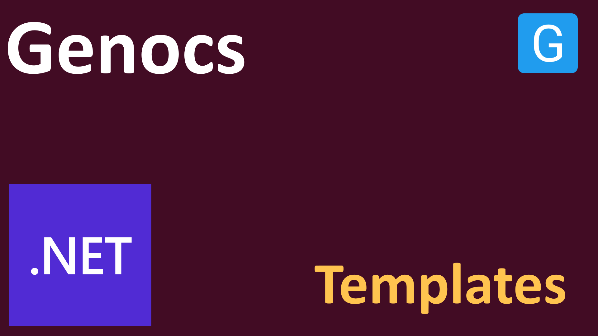

<!-- PROJECT SHIELDS -->

[![License][license-shield]][license-url]
[![Build][build-shield]][build-url]
[![Packages][package-shield]][package-url]
[![Downloads][downloads-shield]][downloads-url]
[![Contributors][contributors-shield]][contributors-url]
[![Forks][forks-shield]][forks-url]
[![Stargazers][stars-shield]][stars-url]
[![Issues][issues-shield]][issues-url]
[![Discord][discord-shield]][discord-url]
[![Gitter][gitter-shield]][gitter-url]
[![Twitter][twitter-shield]][twitter-url]
[![Twitterx][twitterx-shield]][twitterx-url]
[![LinkedIn][linkedin-shield]][linkedin-url]

[license-shield]: https://img.shields.io/github/license/Genocs/microservice-template?color=2da44e&style=flat-square
[license-url]: https://github.com/Genocs/microservice-template/blob/main/LICENSE
[build-shield]: https://github.com/Genocs/microservice-template/actions/workflows/build-and-test.yml/badge.svg?branch=main
[build-url]: https://github.com/Genocs/microservice-template/actions/workflows/build-and-test.yml
[package-shield]: https://img.shields.io/badge/nuget-v.3.1.1-blue?&label=latest&logo=nuget
[package-url]: https://github.com/Genocs/microservice-template/actions/workflows/build-and-test.yml
[downloads-shield]: https://img.shields.io/nuget/dt/Genocs.Microservice.Template.svg?color=2da44e&label=downloads&logo=nuget
[downloads-url]: https://www.nuget.org/packages/Genocs.Microservice.Template
[contributors-shield]: https://img.shields.io/github/contributors/Genocs/microservice-template.svg?style=flat-square
[contributors-url]: https://github.com/Genocs/microservice-template/graphs/contributors
[forks-shield]: https://img.shields.io/github/forks/Genocs/microservice-template?style=flat-square
[forks-url]: https://github.com/Genocs/microservice-template/network/members
[stars-shield]: https://img.shields.io/github/stars/Genocs/microservice-template.svg?style=flat-square
[stars-url]: https://img.shields.io/github/stars/Genocs/microservice-template?style=flat-square
[issues-shield]: https://img.shields.io/github/issues/Genocs/microservice-template?style=flat-square
[issues-url]: https://github.com/Genocs/microservice-template/issues
[discord-shield]: https://img.shields.io/discord/1106846706512953385?color=%237289da&label=Discord&logo=discord&logoColor=%237289da&style=flat-square
[discord-url]: https://discord.com/invite/fWwArnkV
[gitter-shield]: https://img.shields.io/badge/chat-on%20gitter-blue.svg
[gitter-url]: https://gitter.im/genocs/
[twitter-shield]: https://img.shields.io/twitter/follow/genocs?color=1DA1F2&label=Twitter&logo=Twitter&style=flat-square
[twitter-url]: https://twitter.com/genocs
[linkedin-shield]: https://img.shields.io/badge/-LinkedIn-black.svg?style=flat-square&logo=linkedin&colorB=555
[linkedin-url]: https://www.linkedin.com/in/giovanni-emanuele-nocco-b31a5169/
[twitterx-shield]: https://img.shields.io/twitter/url/https/twitter.com/genocs.svg?style=social
[twitterx-url]: https://twitter.com/genocs

<!-- PROJECT LOGO -->
<p align="center">
  <a href="https://github.com/Genocs/microservice-template">
    
  </a>
  <h3 align="center">.NET Microservice Template</h3>
  <p align="center">
    Open-source .NET 10 template for setting up microservice solutions with Clean Architecture, multi-tenancy, and production-ready infrastructure.
    <br />
    <a href="https://genocs-blog.netlify.app/microservice-template/general/getting-started/"><strong>Read the Documentation »</strong></a>
    <br />
    <br />
    <a href="https://github.com/Genocs/microservice-template/issues">Report Bug</a>
    ·
    <a href="https://github.com/Genocs/microservice-template/issues">Request Feature</a>
    .
    <a href="https://github.com/Genocs/microservice-template/issues">Request Documentation</a>
  </p>
</p>

# Genocs .NET Web API Microservice Template

The Genocs .NET Web API Microservice Template is a starting point for your next `.NET 10 Clean Architecture` solution. It includes essential packages and features, including built-in multi-tenancy support.

> As the name suggests, this is an API/server template. Client templates that consume this API are available under the `@genocs` organization.
>
> - [Blazor WebAssembly Template](https://github.com/Genocs/blazor-wasm-template)


## 📋 Table of Contents

- [Features](#-features)
- [Prerequisites](#prerequisites)
- [Getting Started](#-getting-started)
- [Setup Infrastructure](#setup-infrastructure)
- [Genocs CLI](#genocs-cli)
- [Makefile](#makefile)
- [Containerization](#containerization)
- [Docker Compose](#docker-compose)
- [Cloud Deployment with Terraform and AWS ECS](#cloud-deployment-with-terraform-and-aws-ecs)
- [Links and Documentation](#links-and-documentation)
- [Community](#community)
- [Support](#support)

## ✨ Features

- Clean architecture template spanning Domain, Application, Infrastructure, and WebApi projects.
- Built-in multi-tenant foundation (Finbuckle) with per-tenant and shared database strategies.
- Production-ready infrastructure: background jobs, caching, localization, auditing, and real-time notifications.
- Developer tooling out of the box: Makefile automation, Terraform modules, Docker Compose, Postman and Thunder collections.

## 📋 Prerequisites

- [.NET 10 SDK](https://dotnet.microsoft.com/download/dotnet/10.0)
- **IDE** (choose one):
  - [Visual Studio 2026](https://visualstudio.microsoft.com/) (recommended)
  - [Visual Studio Code](https://code.visualstudio.com/) with C# extension
  - [JetBrains Rider](https://www.jetbrains.com/rider/)
- **Optional for development**:
  - [Docker Desktop](https://www.docker.com/products/docker-desktop) for containerization
  - MongoDB, SQL Server
  - [Node.js 16+](https://nodejs.org/en/download)


### 🏗️ Folder structure

The template generates a solution with the following structure:

```plaintext
root
  ├── src/
  |   ├── Application/             # CQRS commands, queries, validations, business workflows
  |   ├── Contracts/               # Shared DTOs, integration events, notifications, permissions
  |   ├── Domain/                  # Entities, aggregates, domain events, value objects
  |   ├── Infrastructure/          # EF Core persistence, caching, jobs, external integrations
  |   ├── Migrators.MSSQL/         # SQL Server migrations and tooling
  |   ├── Migrators.MySQL/         # MySQL migrations and tooling
  |   ├── Migrators.Oracle/        # Oracle migrations and tooling
  |   ├── Migrators.PostgreSQL/    # PostgreSQL migrations and tooling
  |   ├── Migrators.SqLite/        # SQLite migrations and tooling
  |   └── WebApi/                  # Host application, configuration, controllers, SignalR hub
  ├── tests/
      └── Infrastructure.Tests/    # Automated tests for persistence, validation, caching

```

### Features

- :white_check_mark: Built on [.NET 10](https://dotnet.microsoft.com/en-us/) with Clean Architecture layering (Domain, Application, Infrastructure, WebApi).
- :white_check_mark: Domain-driven design with CQRS (MediatR), Mapster mappings, FluentValidation, and specification support.
- :white_check_mark: Multi-tenancy powered by [Finbuckle](https://www.finbuckle.com/) with tenant management APIs, shared/per-tenant databases, and subscription upgrades.
- :white_check_mark: Database providers for PostgreSQL, SQL Server, MySQL, Oracle, and SQLite via Entity Framework Core 9.
- :white_check_mark: Optimized read path with integrated [Dapper](https://www.learndapper.com/) repository alongside EF Core.
- :white_check_mark: Background job processing through Hangfire with dashboard support and multi-provider storage.
- :white_check_mark: Observability with Serilog (console, file, Seq, Elasticsearch, AWS), structured logging, and auditing pipeline.
- :white_check_mark: Distributed caching abstractions with StackExchange Redis and per-tenant cache segregation.
- :white_check_mark: Authentication via JWT bearer tokens and Azure AD, plus fine-grained permission-based authorization.
- :white_check_mark: Localization using OrchardCore PO files, configurable cultures, and UI-ready resource catalogs.
- :white_check_mark: OpenAPI/NSwag integration for client generation, versioned APIs, and security schemas.
- :white_check_mark: Excel export (ClosedXML), file storage abstractions, Razor-based email templates, and MailKit delivery.
- :white_check_mark: Real-time notifications with SignalR and Redis backplane support.
- :white_check_mark: Tooling for real-world deployments: Makefile automation, Docker Compose samples, Terraform modules, and Postman/Thunder Client collections.
- :white_check_mark: Code analysis and StyleCop configuration, plus infrastructure-focused automated tests.
- :white_check_mark: Comprehensive documentation hosted on [Genocs Netlify](https://genocs-blog.netlify.app) and an active community.

### .NET template documentation
For more information about .NET templating, see:
- [.NET custom templates](https://learn.microsoft.com/dotnet/core/tools/custom-templates)
- [dotnet/templating](https://github.com/dotnet/templating)


## 🚀 Getting Started
Choose one of the following installation options:

- Use the `genocs cli` tool to install and generate the latest release.
- Use `dotnet new install` to install a specific template version.
- Fork the repository if you want to keep a customizable copy synchronized with upstream changes.

> Make sure your development environment is configured. Read the [development environment guide](https://genocs-blog.netlify.app/microservice-template/general/development-environment/).


### Install the Template

```bash
# Install the latest version
dotnet new install Genocs.Microservice.Template

# Or install a specific version
dotnet new install Genocs.Microservice.Template::3.1.1

# View all available options
dotnet new gnx-microservice --help

# Example with custom options
dotnet new gnx-microservice --name <CompanyName.ProjectName.ServiceName>
```

### Build the template locally

Make sure NuGet is installed on your machine. Download the latest version from [nuget.org](https://www.nuget.org/downloads), then:
- Download the latest NuGet executable.
- Add `nuget.exe` to your `PATH` environment variable.
- Run the following commands:

```bash
# To clone the repository
git clone https://github.com/Genocs/microservice-template
cd microservice-template

# To pack and build the template
dotnet pack ./src/Package.Template.csproj -p:PackageVersion=3.1.1 --configuration Release --output ./out

# To install the template
dotnet new install ./out/Genocs.Microservice.Template.3.1.1.nupkg

# To get the list of available templates
dotnet new gnx-microservice --help

# To uninstall the template (if you want to remove it)
dotnet new uninstall Genocs.Microservice.Template

# Example of creating a new project with full functionality
dotnet new gnx-microservice --name <CompanyName.ProjectName.ServiceName> -gc full
```

### Miscellaneous

Useful commands:

```bash
# How to get the list of installed templates
dotnet new -u

# How to get the list of templates
dotnet new list
```

### Forking the Repository

Use this approach if you want to keep your source code synchronized with upstream changes. To start from this repository, choose whether to fork, clone, or download it.

- Make a fork of this repository in your GitHub account.
- Create your new `microservice-template` personal project by cloning the forked repository on your personal GitHub.
- Setup an upstream remote on your personal project pointing to your forked repository using command
    ```bash
    git remote add upstream https://github.com/{githubuseraccount}/microservice-template
    git remote set-url --push upstream DISABLE
    ```

## Documentation

Read Documentation related to this template here - [Template Documentation](https://genocs-blog.netlify.app/microservice-template/)

> Feel free to contribute to the Documentation Repository - [Contribute Documentation](https://github.com/Genocs/genocs-library-docs)


---
## Setup Infrastructure

The template includes preconfigured infrastructure that is ready to use. You can use the default configuration or modify it for your environment.

Supported infrastructure components:
- PostgreSQL
- SQL Server
- MySQL
- Oracle
- SQLite

The default database provider is SQL Server. Change `DatabaseSettings__DBProvider` in `docker-compose.yml` to use another supported provider.

---
## Genocs CLI

Use the `genocs cli` tool to install the template and create a new solution. The CLI is a console application that scaffolds solutions from the Genocs template.

### Installation

After installing .NET, install the CLI tool.

```bash
dotnet tool install -g genocs.cli
genocs install
```

This installs the CLI tool and associated templates. You are now ready to create your first project.

[Documentation](https://genocs-blog.netlify.app/cli/)

### Get started

To create a solution with the Genocs .NET Web API template:

Navigate to the directory where you want to create the solution and open a terminal.

Run the following command. Note that, in this demonstration, I am naming my new solution as `CompanyName.ProjectName.ServiceName`.

```bash
genocs micro-webapi [n|new] CompanyName.ProjectName.ServiceName
```

This creates a new .NET 10 Web API solution using the template.
For more details, see the [template overview](https://genocs-blog.netlify.app/templating/multitenancy-template/general/overview/).

### Update

To update the CLI tool and templates, run:

```bash
dotnet tool update genocs.cli --global
genocs update
```

### Run the template

---
## Makefile

The generated solution includes a Makefile for common development tasks. From the solution root, open a terminal.

To build the solution:

```bash
make build
```

By default, the solution uses PostgreSQL. Make sure a PostgreSQL instance is running on your machine. Update the credentials in `src/WebApi/Configurations/database.json` and `src/WebApi/Configurations/hangfire.json`, if necessary, and then start the API server.

```bash
make start
```

The application connects to the configured PostgreSQL database, creates the required tables, and seeds initial data.

You can test the API with one of these options:

1. Swagger at `localhost:5001/swagger`
2. Postman collections are available `./postman`
3. Thunder Client for VS Code. Install the [Thunder Client](https://www.thunderclient.com/) extension for VS Code.

The default credentials are:

```json
{
  "email": "admin@root.com",
  "password": "<YOUR_ROOT_PASSWORD>"
}
```

Open Postman, Thunder Client, or Swagger.

In Identity, select `get-token`.

This is a **POST** request with the credentials shown above. Pass the tenant ID in the `tenant` header. The default tenant ID is `root`.

Here is a sample cURL command for obtaining the tokens:

```curl
curl -X POST \
  'https://localhost:5001/api/tokens' \
  --header 'Accept: */*' \
  --header 'tenant: root' \
  --header 'Accept-Language: en-US' \
  --header 'Content-Type: application/json' \
  --data-raw '{
  "email": "admin@root.com",
  "password": "<YOUR_ROOT_PASSWORD>"
}'
```

Example response:

```json
{
  "token": "<your token>",
  "refreshToken": "<your refresh token>",
  "refreshTokenExpiryTime": "2025-01-01T00:00:00.0000000Z"
}
```

Pass the returned `token` in the request headers to authenticate calls to the Genocs API.

For further steps and details, [Template Overview](https://genocs-blog.netlify.app/templating/multitenancy-template/general/overview/)

## Containerization

The project is configured for containerization as a .NET 10 application, so a Dockerfile is required to containerize the Web API.

To build a Docker image, make sure Docker Desktop or the Docker engine is running, then execute this command from the solution root:

```bash
make publish
```

You can also push the Docker image directly to Docker Hub or another supported registry:

```bash
make publish-to-hub
```

Update the Docker registry/repository URL in the Makefile before pushing.

## Docker Compose

This project includes Docker Compose examples for running the Web API and database containers locally:

```bash
# Start the Web API and PostgreSQL containers
make dcu
# Stop the Web API and PostgreSQL containers
make dcd
```

Examples are also available for MySQL and SQL Server. You can find the Compose files in `./infrastructure`. See [infrastructure/docker/README.md](./infrastructure/docker/README.md) for details.

## Cloud Deployment with Terraform and AWS ECS

AWS cloud deployment is supported with Terraform. The Terraform files are available in the `./terraform` folder.

### Prerequisites

- Install Terraform
- Install and configure an AWS CLI profile so Terraform can provision resources. See [AWS credentials management](https://www.youtube.com/watch?v=oY0-1mj4oCo&ab_channel=MukeshMurugan).

The Terraform folder contains two subfolders:
- backend
- environments/staging

The `backend` folder is used for Terraform state management and locking. Complete a one-time setup by navigating to the folder and running:

```bash
terraform init
terraform apply -auto-approve
```

This creates the required S3 buckets and DynamoDB table.

In the `environments/staging` folder, run:

```bash
terraform init
```

Next, edit `terraform.tfvars` to configure values such as:

- project tags
- Docker image name
- ECS cluster name
- Project-specific settings

Return to the solution root and run:

```bash
make ta
```

This evaluates the Terraform configuration and creates an execution plan. After reviewing the plan, enter `yes` to deploy the .NET microservice containers and an RDS PostgreSQL instance. The hosted API URL is returned when provisioning completes.

To destroy the deployed resources, run:

```bash
make td
```

## Links and Documentation

  - [Overview](https://genocs-blog.netlify.app/microservice-template/general/overview/)
  - [Getting Started](https://genocs-blog.netlify.app/microservice-template/general/getting-started/)
  - [Development Environment](https://genocs-blog.netlify.app/microservice-template/general/development-environment/)
  - [Participate in Q&A and general discussions](https://github.com/Genocs/microservice-template/discussions)

## Changelog

View the complete [changelog](https://github.com/Genocs/microservice-template/blob/main/CHANGELOG.md).

## Community

- Discord [@genocs](https://discord.com/invite/fWwArnkV)
- Facebook Page [@genocs](https://facebook.com/Genocs)
- YouTube channel [@genocs](https://youtube.com/c/genocs)

For step-by-step instructions, follow these guides on [Discord](https://discord.com/channels/878181478972928011/892573122186838046/933513103688224838) and [GitHub Gist](https://gist.github.com/0xjac/85097472043b697ab57ba1b1c7530274).

## Support

If this project has helped you learn or improve your work, you can support it in several ways:

- ⭐ Leave a star!
- 🥇 Recommend this project to your colleagues.
- 🦸 Endorse the project on LinkedIn for ASP.NET Core: [Connect via LinkedIn](https://www.linkedin.com/in/giovanni-emanuele-nocco-b31a5169/)
- ☕ If you want to support this project over the long term, consider [buying me a coffee](https://www.buymeacoffee.com/genocs)!

[](https://www.buymeacoffee.com/genocs)

## Financial Contributors

Become a financial contributor and help me sustain the project.

**Support the Project** on [Opencollective](https://opencollective.com/genocs)
