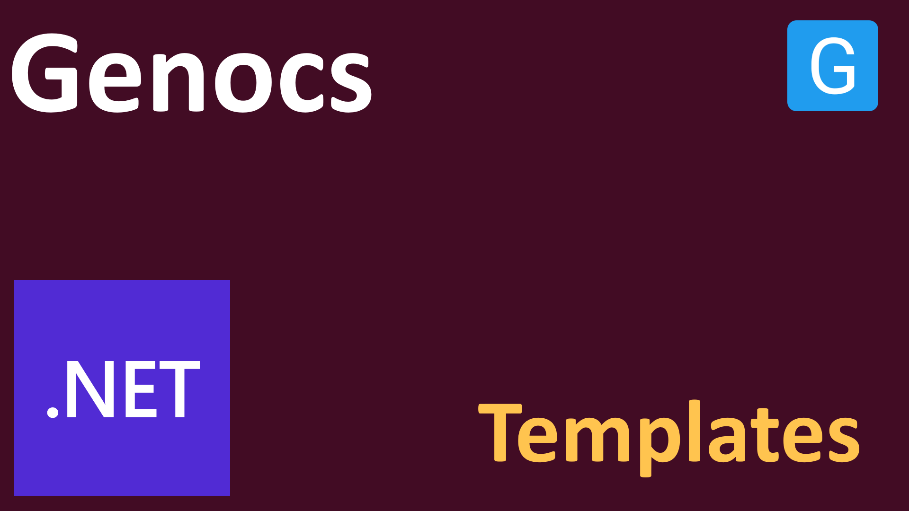

<!-- PROJECT SHIELDS -->
[![License][license-shield]][license-url]
[![Build][build-shield]][build-url]
[![Packages][package-shield]][package-url]
[![Downloads][downloads-shield]][downloads-url]
[![Contributors][contributors-shield]][contributors-url]
[![Forks][forks-shield]][forks-url]
[![Stargazers][stars-shield]][stars-url]
[![Issues][issues-shield]][issues-url]
[![Discord][discord-shield]][discord-url]
[![Gitter][gitter-shield]][gitter-url]
[![Twitter][twitter-shield]][twitter-url]
[![Twitterx][twitterx-shield]][twitterx-url]
[![LinkedIn][linkedin-shield]][linkedin-url]

[license-shield]: https://img.shields.io/github/license/Genocs/microservice-template?color=2da44e&style=flat-square
[license-url]: https://github.com/Genocs/microservice-template/blob/main/LICENSE
[build-shield]: https://github.com/Genocs/microservice-template/actions/workflows/build-and-test.yml/badge.svg?branch=main
[build-url]: https://github.com/Genocs/microservice-template/actions/workflows/build-and-test.yml
[package-shield]: https://img.shields.io/badge/nuget-v.3.1.1-blue?&label=latests&logo=nuget
[package-url]: https://github.com/Genocs/microservice-template/actions/workflows/build-and-test.yml
[downloads-shield]: https://img.shields.io/nuget/dt/Genocs.Microservice.Template.svg?color=2da44e&label=downloads&logo=nuget
[downloads-url]: https://www.nuget.org/packages/Genocs.Microservice.Template
[contributors-shield]: https://img.shields.io/github/contributors/Genocs/microservice-template.svg?style=flat-square
[contributors-url]: https://github.com/Genocs/microservice-template/graphs/contributors
[forks-shield]: https://img.shields.io/github/forks/Genocs/microservice-template?style=flat-square
[forks-url]: https://github.com/Genocs/microservice-template/network/members
[stars-shield]: https://img.shields.io/github/stars/Genocs/microservice-template.svg?style=flat-square
[stars-url]: https://img.shields.io/github/stars/Genocs/microservice-template?style=flat-square
[issues-shield]: https://img.shields.io/github/issues/Genocs/microservice-template?style=flat-square
[issues-url]: https://github.com/Genocs/microservice-template/issues
[discord-shield]: https://img.shields.io/discord/1106846706512953385?color=%237289da&label=Discord&logo=discord&logoColor=%237289da&style=flat-square
[discord-url]: https://discord.com/invite/fWwArnkV
[gitter-shield]: https://img.shields.io/badge/chat-on%20gitter-blue.svg
[gitter-url]: https://gitter.im/genocs/
[twitter-shield]: https://img.shields.io/twitter/follow/genocs?color=1DA1F2&label=Twitter&logo=Twitter&style=flat-square
[twitter-url]: https://twitter.com/genocs
[linkedin-shield]: https://img.shields.io/badge/-LinkedIn-black.svg?style=flat-square&logo=linkedin&colorB=555
[linkedin-url]: https://www.linkedin.com/in/giovanni-emanuele-nocco-b31a5169/
[twitterx-shield]: https://img.shields.io/twitter/url/https/twitter.com/genocs.svg?style=social
[twitterx-url]: https://twitter.com/genocs




## Genocs .NET Web API Microservice Template

Genocs .NET Web API Microservice Template is a starting point for your next `.NET 10 Clean Architecture` solution that incorporates the most essential packages and features your projects will ever need including out of the box Multi-Tenancy support.

> As the name suggests, this is an API / Server Template. You can find other Client Template that consume this API under `@genocs` handle.
> - Find `Blazor Wasm Template` here - [Blazor Wasm Template](https://github.com/Genocs/blazor-wasm-template)

The template can be used with the `genocs cli`, `dotnet new` command or with the `Visual Studio 2026`, `Visual Studio Code` IDEs.


## Goals

The goal of this template is to provide a complete and feature-rich starting point for any .NET Developer / Team to kick-start their project using .NET 10 Microservices architecture. This also serves the purpose of learning advanced concepts and implementations such as `Multitenancy, CQRS, Onion Architecture, Clean Coding standards, Docker Concepts, Cloud Deployments with Terraform to AWS, CI/CD Pipelines & Workflows` and so on.

## Features

- :white_check_mark: Built on [.NET 10](https://dotnet.microsoft.com/en-us/)
- :white_check_mark: Follows Clean Architecture Principles
- :white_check_mark: Domain Driven Design
- :white_check_mark: Cloud Ready. Can be deployed to AWS Infrastructure as ECS Containers using Terraform
- :white_check_mark: Docker-Compose File Examples
- :white_check_mark: Documented at [genocs netlify](https://genocs-blog.netlify.app)
- :white_check_mark: Multi Tenancy Support with [Finbuckle](https://www.finbuckle.com/)
  - :white_check_mark: Create Tenants with Multi Database / Shared Database Support
  - :white_check_mark: Activate / Deactivate Tenants on Demand
  - :white_check_mark: Upgrade Subscription of Tenants - Add More Validity Months to each tenant!
- :white_check_mark: Supports MySQL, MSSQL, Oracle, PostgreSQL, SQLite
- :white_check_mark: Uses [Entity Framework Core 9.0](https://learn.microsoft.com/en-us/ef/core/) as DB Abstraction
- :white_check_mark: Flexible Repository Pattern
- :white_check_mark: [Dapper](https://www.learndapper.com/) Integration for Optimal Performance
- :white_check_mark: Serilog Integration with various Sinks - File, SEQ, Kibana
- :white_check_mark: OpenAPI - Supports Client Service Generation
- :white_check_mark: Mapster Integration for Quicker Mapping
- :white_check_mark: API Versioning
- :white_check_mark: Response Caching - Distributed Caching + REDIS
- :white_check_mark: Fluent Validations
- :white_check_mark: Audit Logging
- :white_check_mark: Advanced User & Role Based Permission Management
- :white_check_mark: Code Analysis & StyleCop Integration with Rulesets
- :white_check_mark: JSON Based Localization with Caching
- :white_check_mark: Hangfire Support - Secured Dashboard
- :white_check_mark: File Storage Service
- :white_check_mark: Test Projects
- :white_check_mark: JWT & Azure AD Authentication
- :white_check_mark: MediatR - CQRS
- :white_check_mark: SignalR Notifications
- :white_check_mark: MassTransit Integration
- :white_check_mark: & Much More

## Documentation

Read Documentation related to this template here - [Template Documentation](https://genocs-blog.netlify.app/microservice-template/)

> Feel free to contribute to the Documentation Repository - [Contribute Documentation](https://github.com/Genocs/genocs-library-docs)


---
## Setup Infrastructure

The template includes preconfigured infrastructure that is ready to use. You can use the default configuration or modify it for your environment.

Supported infrastructure components:
- PostgreSQL
- SQL Server
- MySQL
- Oracle
- SQLite

The default database provider is SQL Server. Change `DatabaseSettings__DBProvider` in `docker-compose.yml` to use another supported provider.

---
## Genocs CLI

Use the `genocs cli` tool to install the template and create a new solution. The CLI is a console application that scaffolds solutions from the Genocs template.

### Installation

After installing .NET, install the CLI tool.

```bash
dotnet tool install -g genocs.cli
genocs install
```

This installs the CLI tool and associated templates. You are now ready to create your first project.

[Documentation](https://genocs-blog.netlify.app/cli/)

### Get started

To create a solution with the Genocs .NET Web API template:

Navigate to the directory where you want to create the solution and open a terminal.

Run the following command. Note that, in this demonstration, I am naming my new solution as `CompanyName.ProjectName.ServiceName`.

```bash
genocs micro-webapi [n|new] CompanyName.ProjectName.ServiceName
```

This creates a new .NET 10 Web API solution using the template.
For more details, see the [template overview](https://genocs-blog.netlify.app/templating/multitenancy-template/general/overview/).

### Update

To update the CLI tool and templates, run:

```bash
dotnet tool update genocs.cli --global
genocs update
```

### Run the template

---
## Makefile

The generated solution includes a Makefile for common development tasks. From the solution root, open a terminal.

To build the solution:

```bash
make build
```

By default, the solution uses PostgreSQL. Make sure a PostgreSQL instance is running on your machine. Update the credentials in `src/WebApi/Configurations/database.json` and `src/WebApi/Configurations/hangfire.json`, if necessary, and then start the API server.

```bash
make start
```

The application connects to the configured PostgreSQL database, creates the required tables, and seeds initial data.

You can test the API with one of these options:

1. Swagger at `localhost:5001/swagger`
2. Postman collections are available `./postman`
3. Thunder Client for VS Code. Install the [Thunder Client](https://www.thunderclient.com/) extension for VS Code.

The default credentials are:

```json
{
  "email": "admin@root.com",
  "password": "<YOUR_ROOT_PASSWORD>"
}
```

Open Postman, Thunder Client, or Swagger.

In Identity, select `get-token`.

This is a **POST** request with the credentials shown above. Pass the tenant ID in the `tenant` header. The default tenant ID is `root`.

Here is a sample cURL command for obtaining the tokens:

```curl
curl -X POST \
  'https://localhost:5001/api/tokens' \
  --header 'Accept: */*' \
  --header 'tenant: root' \
  --header 'Accept-Language: en-US' \
  --header 'Content-Type: application/json' \
  --data-raw '{
  "email": "admin@root.com",
  "password": "<YOUR_ROOT_PASSWORD>"
}'
```

Example response:

```json
{
  "token": "<your token>",
  "refreshToken": "<your refresh token>",
  "refreshTokenExpiryTime": "2025-01-01T00:00:00.0000000Z"
}
```

Pass the returned `token` in the request headers to authenticate calls to the Genocs API.

For further steps and details, [Template Overview](https://genocs-blog.netlify.app/templating/multitenancy-template/general/overview/)

## Containerization

The project is configured for containerization as a .NET 10 application, so a Dockerfile is required to containerize the Web API.

To build a Docker image, make sure Docker Desktop or the Docker engine is running, then execute this command from the solution root:

```bash
make publish
```

You can also push the Docker image directly to Docker Hub or another supported registry:

```bash
make publish-to-hub
```

Update the Docker registry/repository URL in the Makefile before pushing.

## Docker Compose

This project includes Docker Compose examples for running the Web API and database containers locally:

```bash
# Start the Web API and PostgreSQL containers
make dcu
# Stop the Web API and PostgreSQL containers
make dcd
```

Examples are also available for MySQL and SQL Server. You can find the Compose files in `./infrastructure`. See [infrastructure/docker/README.md](./infrastructure/docker/README.md) for details.

## Cloud Deployment with Terraform and AWS ECS

AWS cloud deployment is supported with Terraform. The Terraform files are available in the `./terraform` folder.

### Prerequisites

- Install Terraform
- Install and configure an AWS CLI profile so Terraform can provision resources. See [AWS credentials management](https://www.youtube.com/watch?v=oY0-1mj4oCo&ab_channel=MukeshMurugan).

The Terraform folder contains two subfolders:
- backend
- environments/staging

The `backend` folder is used for Terraform state management and locking. Complete a one-time setup by navigating to the folder and running:

```bash
terraform init
terraform apply -auto-approve
```

This creates the required S3 buckets and DynamoDB table.

In the `environments/staging` folder, run:

```bash
terraform init
```

Next, edit `terraform.tfvars` to configure values such as:

- project tags
- Docker image name
- ECS cluster name
- Project-specific settings

Return to the solution root and run:

```bash
make ta
```

This evaluates the Terraform configuration and creates an execution plan. After reviewing the plan, enter `yes` to deploy the .NET microservice containers and an RDS PostgreSQL instance. The hosted API URL is returned when provisioning completes.

To destroy the deployed resources, run:

```bash
make td
```

## Links and Documentation

  - [Overview](https://genocs-blog.netlify.app/microservice-template/general/overview/)
  - [Getting Started](https://genocs-blog.netlify.app/microservice-template/general/getting-started/)
  - [Development Environment](https://genocs-blog.netlify.app/microservice-template/general/development-environment/)
  - [Participate in Q&A and general discussions](https://github.com/Genocs/microservice-template/discussions)

## Changelog

View the complete [changelog](https://github.com/Genocs/microservice-template/blob/main/CHANGELOG.md).

## Community

- Discord [@genocs](https://discord.com/invite/fWwArnkV)
- Facebook Page [@genocs](https://facebook.com/Genocs)
- YouTube channel [@genocs](https://youtube.com/c/genocs)

For step-by-step instructions, follow these guides on [Discord](https://discord.com/channels/878181478972928011/892573122186838046/933513103688224838) and [GitHub Gist](https://gist.github.com/0xjac/85097472043b697ab57ba1b1c7530274).

## Support

If this project has helped you learn or improve your work, you can support it in several ways:

- ⭐ Leave a star!
- 🥇 Recommend this project to your colleagues.
- 🦸 Endorse the project on LinkedIn for ASP.NET Core: [Connect via LinkedIn](https://www.linkedin.com/in/giovanni-emanuele-nocco-b31a5169/)
- ☕ If you want to support this project over the long term, consider [buying me a coffee](https://www.buymeacoffee.com/genocs)!

[](https://www.buymeacoffee.com/genocs)

## Financial Contributors

Become a financial contributor and help me sustain the project.

**Support the Project** on [Opencollective](https://opencollective.com/genocs)
